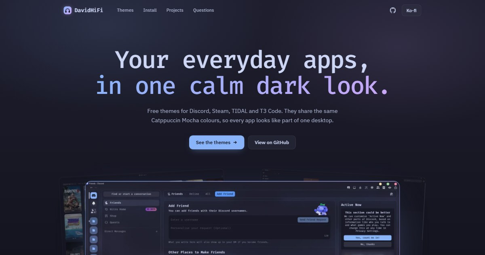

# DavidHiFi

**The source of davidhifi.github.io, the home page for my Catppuccin Mocha themes and Windows projects.**

One page with every theme, how to install it, and links to the rest of my work.

  

---

## Installation

You don't need to install anything to use the site. Open [davidhifi.github.io](https://davidhifi.github.io).

To run a copy on your own PC:

1. Clone the repo.
2. In the repo folder, run `python -m http.server 8000`.
3. Open `http://localhost:8000`.

## Features

### On the page

- **Themes:** MochaCord, MochaSteam, MochaTidal and T3 Code Enhanced, each with a picture and what it needs.
- **Install steps:** short steps for each theme, with a copy button for the MochaCord link.
- **Other projects:** HaloCord, my Windows 11 mods, FreeDictate, Seamless Download Manager, Blutac Launcher and the Quality Of Life mods.
- **Last updated:** each card shows when its repo last changed, read from GitHub on each visit.

### How it's built

- **Plain files:** one HTML page, one stylesheet and one small script. No framework and no build step.
- **Nothing from other sites:** fonts and pictures are served from this repo. The only outside request is the GitHub one for the update dates.
- **Works everywhere:** laid out for phone, tablet and desktop, with keyboard focus and reduced motion respected.

## Contributing

Spotted a typo, a broken link or a layout bug? Open an issue with a screenshot.

## Star history

Thanks to everyone who stopped by.

<a href="https://www.star-history.com/?repos=DavidHiFi%2Fdavidhifi.github.io&amp;type=date">
  <picture>
    <source media="(prefers-color-scheme: dark)" srcset="https://api.star-history.com/chart?repos=DavidHiFi/davidhifi.github.io&amp;type=date&amp;theme=dark&amp;legend=top-left" />
    <source media="(prefers-color-scheme: light)" srcset="https://api.star-history.com/chart?repos=DavidHiFi/davidhifi.github.io&amp;type=date" />
    
  </picture>
</a>

## Credits

- **Author:** Myself, [DavidHiFi](https://github.com/DavidHiFi)

| Who | What |
|---|---|
| **Catppuccin** ([palette](https://github.com/catppuccin/catppuccin)) | The Mocha colours used across the whole site. |
| **Nikita Prokopov** ([Fira Code](https://github.com/tonsky/FiraCode)) | The heading font, under the SIL Open Font License. |
| **IBM** ([IBM Plex](https://github.com/IBM/plex)) | IBM Plex Sans, the body font, under the SIL Open Font License. |

Built on [GitHub Pages](https://pages.github.com), with plain HTML, CSS and JavaScript.

> Missing or wrong credit? [Open an issue](https://github.com/DavidHiFi/davidhifi.github.io/issues/new) and I'll fix it.

## Disclaimers

Most of this site's code was developed with AI coding agents, including Claude Code, Codex and OpenCode. No single AI agent made the site. The themes and the screenshots of them are my own work.

The site sets no cookies and has no tracking. Your browser asks GitHub for each repo's last update date, and the answer is kept only for that visit.
